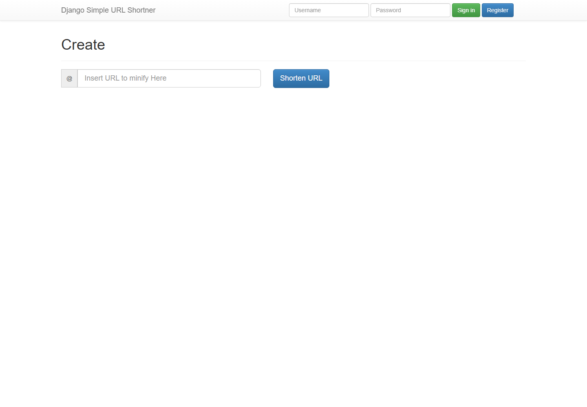
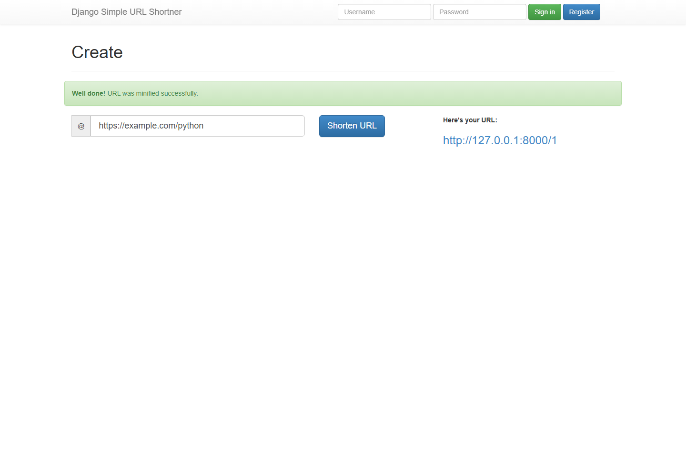

# Django Simple URL Shortener

[](https://github.com/ricardodani/django-simple-url-shortner/actions/workflows/ci.yml)


A small, self-hosted URL shortener built as a reusable Django application. It
creates compact base-62 links, supports optional user accounts, and keeps
deployment under your control.

The package is published on [PyPI](https://pypi.org/project/django-simple-url-shortner/).

## Screenshots

The screenshots below are generated by the repository's Playwright script.

| Home page | Shortened URL |
| --- | --- |
|  |  |

## Features

- Shorten and permanently redirect to valid HTTP or HTTPS URLs.
- Save links for signed-in users and browse them with pagination.
- Generate compact, deterministic base-62 short codes by default, with a
  configurable encoder contract for custom code formats.
- Use Django's built-in authentication, forms, templates, and ORM.
- Responsive interface styled with locally bundled Bootstrap 5.3.9 assets.
- Install the Django app independently of the included demo project.

## Compatibility

| Component | Supported version |
| --- | --- |
| Python | 3.12–3.15 |
| Django | 6.1.x |
| Database | SQLite for local development; configure Django's database settings for deployment |

The project is tested against all listed Python versions in CI. Django support
follows the official [Python compatibility table](https://docs.djangoproject.com/en/6.1/faq/install/).

## Quick start from source

```powershell
git clone https://github.com/ricardodani/django-simple-url-shortner.git
cd django-simple-url-shortner
py -3.15 -m venv .venv
.\.venv\Scripts\Activate.ps1
python -m pip install --upgrade pip
python -m pip install -e .
python simple_url_shortner\manage.py migrate
python simple_url_shortner\manage.py runserver
```

Open <http://127.0.0.1:8000/>. On macOS or Linux, create and activate the
virtual environment with `python3.15 -m venv .venv` and
`source .venv/bin/activate`.

## Add the app to a Django project

Install it from PyPI with:

```bash
python -m pip install django-simple-url-shortner
```

Register the app and its URL routes in your Django project:

```python
# settings.py
INSTALLED_APPS = [
    # ...
    "urlshortener",
]
```

```python
# urls.py
from django.urls import include, path

urlpatterns = [
    path("", include("urlshortener.urls")),
]
```

Run the app's migrations with `python manage.py migrate`. The app uses Django's
configured user model and cache backend.

## Configuration and deployment

The included demo project reads these environment variables:

| Variable | Purpose | Default |
| --- | --- | --- |
| `DJANGO_DEBUG` | Enable Django debug mode | `true` for local development |
| `DJANGO_SECRET_KEY` | Secret key used when debug mode is disabled | Development-only key when `DJANGO_DEBUG=true` |
| `DJANGO_ALLOWED_HOSTS` | Comma-separated allowed host names | `localhost,127.0.0.1,testserver` |
| `DJANGO_DB_PATH` | SQLite database file path | `simple_url_shortner/db.sqlite3` |

For deployment, set `DJANGO_DEBUG=false`, provide a private
`DJANGO_SECRET_KEY`, configure `DJANGO_ALLOWED_HOSTS`, and use a production
database and cache appropriate to your workload. Never reuse the development
settings as a production configuration. See Django's
[deployment checklist](https://docs.djangoproject.com/en/6.1/howto/deployment/checklist/).

## Short-code encoding

The default encoder converts each saved URL's integer database ID to base 62.
Its alphabet is `0123456789abcdefghijklmnopqrstuvwxyzABCDEFGHIJKLMNOPQRSTUVWXYZ`:
10 digits plus 26 lowercase and 26 uppercase letters. It repeatedly divides
the ID by 62 and uses each remainder as a character, from right to left. For
example, `61` becomes `Z` and `62` becomes `10`.

This is reversible base conversion, not encryption: it uses no secret and does
not hide or protect IDs. Short codes should not be treated as authorization
tokens or as a way to keep URLs private.

To use another encoding, subclass `UrlCodeEncoder` and implement
`encode(value: int) -> str`. The result must be a non-empty string of at most
22 ASCII letters or digits, and must not reuse codes already assigned to other
URLs. If an encoder repeatedly returns codes already in use, saving the URL
fails rather than overwriting another URL's code. Configure the dotted Python
path to the class in the Django project settings:

```python
# myproject/url_codes.py
from urlshortener.converter import UrlCodeEncoder


class HexUrlCodeEncoder(UrlCodeEncoder):
    def encode(self, value: int) -> str:
        if value < 0:
            raise ValueError("value must be non-negative")
        return f"x{value:x}"
```

```python
# settings.py
URLSHORTENER_CODE_ENCODER = "myproject.url_codes.HexUrlCodeEncoder"
```

The encoder is instantiated without arguments when a new URL is saved. Existing
short codes are retained when their URL records are updated.

For keyed hash-based codes, configure the built-in HMAC-SHA256 encoder:

```python
URLSHORTENER_CODE_ENCODER = "urlshortener.converter.HmacUrlCodeEncoder"
```

It uses Django's `SECRET_KEY` and the URL's database ID, truncates HMAC-SHA256
to 128 bits, and encodes those bits in base 62. The minimum fixed width to
represent 128 bits in base 62 is 22 characters
(`ceil(128 / log2(62))`). No finite code is literally unbreakable, but
128-bit keyed codes are impractical to guess by brute force while the secret
remains private. Changing `SECRET_KEY` only affects codes generated afterward;
saved codes remain stored.

If shorter codes are more important than resistance to guessing, the
`ShortHmacUrlCodeEncoder` produces 8-character codes (about 47.6 bits):

```python
URLSHORTENER_CODE_ENCODER = "urlshortener.converter.ShortHmacUrlCodeEncoder"
```

This shorter option is intentionally weaker and should not be used when
guessing or enumeration could expose sensitive destinations.

For random non-sequential codes instead, use the built-in cryptographically
secure random encoder:

```python
URLSHORTENER_CODE_ENCODER = "urlshortener.converter.RandomUrlCodeEncoder"
```

It chooses 16 characters independently from the 62-character alphabet using
Python's `secrets` module, giving about 95 bits of randomness. The database
enforces code uniqueness, and collisions are retried. This makes codes
impractical to predict or enumerate, but a short URL is still a bearer link:
anyone who obtains it can visit it. Do not use a short code as authentication
or access control.

## Development

Install the development tools and Playwright:

```bash
python -m pip install -e ".[dev]"
python -m playwright install chromium
```

Run the unit and Django integration tests:

```bash
coverage run -m pytest
coverage report
```

Run lint, formatting checks, and pre-commit hooks:

```bash
ruff check .
ruff format --check .
mypy
pre-commit run --all-files
```

Run the Playwright end-to-end smoke test and refresh the checked-in screenshots:

```bash
python scripts/capture_screenshots.py
```

The script starts an isolated demo database and local Django server, exercises
URL creation and redirection in Chromium, then writes PNGs to
`docs/screenshots/`. Pass `--output-dir PATH` to write the screenshots
to another directory inside the repository or `--port PORT` to use a different
local port. Add `--headed` to watch the test run in a visible Chromium window.
For safety, output paths outside the repository are rejected.

Build and validate the distribution without publishing it:

```bash
python -m build --sdist --wheel
python -m twine check dist/*
```

## AI and MCP integrations

AI integrations are not part of the core package. If an MCP interface is added,
it should be a separate, optional adapter over the same URL-shortening
operations. The adapter can use the official [MCP Python SDK](https://py.sdk.modelcontextprotocol.io/);
Agno can consume that MCP server when an Agno-based client is useful, without
making Agno a required dependency of this Django application.

## Contributing

Bug reports, focused improvements, and tests are welcome. Please include the
problem being solved, steps to reproduce when relevant, and the checks you ran.
Pull requests require maintainer review and manual approval before merge.

## License

This project is distributed under the GNU General Public License, version 2.
See [LICENSE](LICENSE).
